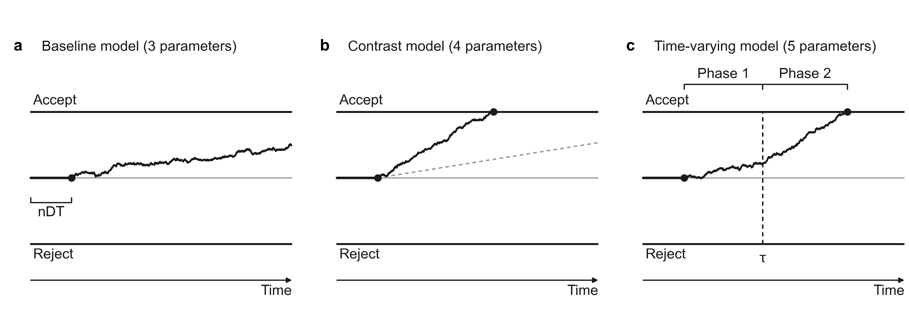
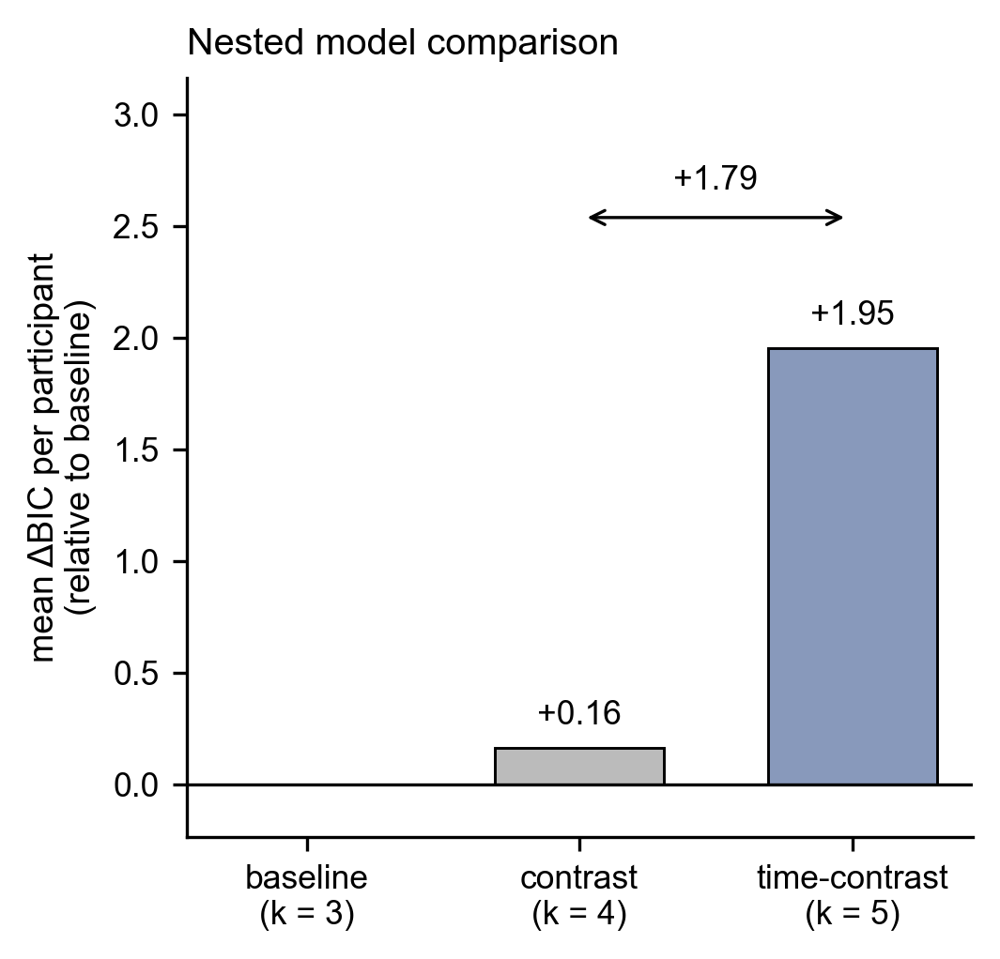
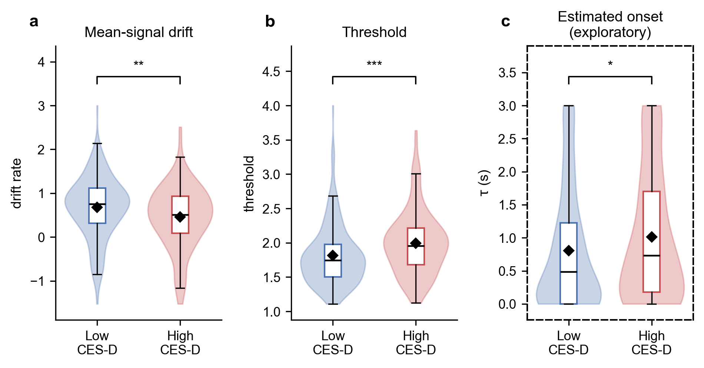
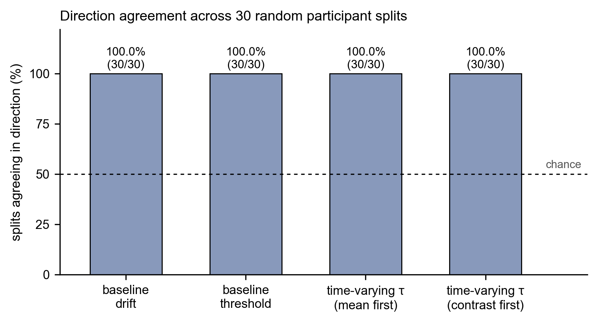
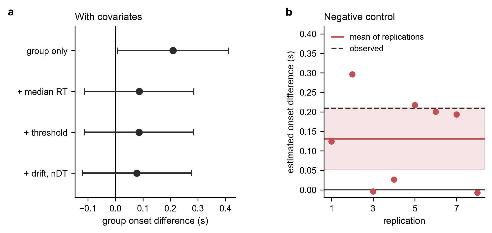

# Depressive symptoms, evidence accumulation and caution in a social decision: code and results

This repository reproduces the analyses in *Depressive symptoms are associated with weaker evidence accumulation and greater caution during social decision-making* (Kim & Yao).

In the ultimatum-game data analysed here, people with elevated depressive symptoms answered offers more slowly than people with few symptoms, and the two groups accepted offers at similar rates. A drift-diffusion model uses choices and response times together to estimate how quickly evidence for a choice builds up, how much evidence a person requires before choosing, and how much time is spent outside the decision itself. In this model, the slower answers of the high depressive-symptom group came with weaker evidence accumulation and greater caution. The model thus gives a process-level account of why response times differed while acceptance rates were similar.

## What the paper finds

Statistics below are Welch t-tests (t, with degrees of freedom in brackets), two-sided p-values, Cohen's d effect sizes, Pearson correlations (r) and 95% confidence intervals (CI). Values for the two groups are given in the order low, then high depressive-symptom group. Tables and figures marked "S" are in the paper's Supplement.

### The question

In the ultimatum game, a proposer offers to split a sum of money and the responder decides whether to accept. If the responder rejects, neither player receives anything. The data are the responder choices from Experiment 4 of Heffner et al. (2021): 351 adults, about 20 offers each. Participants were grouped by the Center for Epidemiologic Studies Depression Scale (CES-D), a self-report questionnaire. The 205 who scored below the conventional cutoff of 16 form the low depressive-symptom group, and the 146 who scored at or above it form the high depressive-symptom group.

The two groups accepted offers at similar rates (0.719 and 0.703; t(324) = −0.62, p = .53). The high depressive-symptom group answered more slowly (median response time 3.18 s and 3.67 s; t(278) = 4.21, p < .001, d = 0.46). The paper asks which part of the decision process produces this slowing.

### How the model describes a decision

On each trial, participants first predicted how much money they would be offered and how they would feel about it. They then saw the offer, rated how they actually felt, and decided whether to accept. Feelings were rated for valence, that is, how pleasant or unpleasant they were. Each offer therefore carries two signals. The reward prediction error is the received minus the predicted amount. The emotion prediction error is the experienced minus the predicted valence rating. Each signal was divided by its standard deviation across all trials, which puts the two on a common, unitless scale. The two are strongly correlated across trials (r = .757), so the model uses their mean, which tracks what they have in common, and their contrast, half the reward signal minus the emotion signal. The contrast is positive when the monetary outcome exceeds expectations by more than the emotional outcome does.

In a drift-diffusion model, evidence starts midway between an Accept and a Reject boundary and moves noisily toward one of them. The first boundary reached determines the choice. The time taken to reach it, plus the non-decision time, gives the response time. Three quantities describe the process:

- the **drift rate**, how strongly the offer's mean signal pushes the evidence toward a boundary. A lower drift rate means evidence builds up more weakly, so choices take longer and follow the offer's value less closely;
- the **decision threshold**, the distance from the starting point to each boundary. A wider threshold means more evidence is needed before a choice, which makes the decision slower and more cautious;
- the **non-decision time**, the time spent encoding the offer and making the key press.

Drift rate and threshold are in model units, set by fixing the noise of the accumulation at 1.4. The paper fits three models, each adding one component to the previous one (Fig. 1). The baseline model uses the mean signal only. The contrast model adds a weight for the contrast signal. The time-varying model lets the contrast signal join the accumulation at a later onset time τ.



*Fig. 1. Schematic evidence traces for the baseline model (a), the contrast model (b) and the time-varying model (c). nDT, non-decision time. In c, the mean signal alone drives the evidence until τ, and the contrast signal is added from τ on.*

### Which model the data favour

The Bayesian information criterion (BIC) weighs fit against the number of parameters, and a lower value is better. The baseline model had the lowest mean BIC (Fig. 2). Adding the contrast signal raised BIC by 0.16 per participant, a small difference, and adding the onset raised it by a further 1.79. The baseline model had the lowest BIC for 62.4% of the low and 68.5% of the high depressive-symptom group. The paper therefore takes its group comparisons of drift rate and threshold from the baseline model.



*Fig. 2. Mean BIC per participant relative to the baseline model (k, number of parameters; the time-varying model is labelled "time-contrast").*

### Main result: weaker evidence accumulation and greater caution

In the baseline model, the high depressive-symptom group had a lower drift rate (0.677 and 0.461; t(306) = 2.80, p = .005, d = 0.30) and a wider decision threshold (1.82 and 2.00; t(303) = 3.63, p < .001, d = 0.40) (Fig. 3a–b). Both differences held with the CES-D total as a continuous score (drift r(349) = −0.18, threshold r(349) = 0.18, both p < .001) and after statistical adjustment for age and gender (Supplement S6). The time-varying model gave the same two differences (drift t(295) = 2.29, p = .023; threshold t(315) = 3.39, p < .001), so they hold in both the simplest and the largest model. The paper leaves the group difference in non-decision time uninterpreted, because in the time-varying model 16.5% of its estimates sit at the 3 s upper bound (Supplement S3).

The choices themselves show the lower drift rate. In a trial-level model of acceptance, acceptance in the high depressive-symptom group depended less on the offer's mean signal (group × mean-signal interaction β = −0.54, SE = 0.23, p = .019).



*Fig. 3. Per-participant estimates by group. a, Mean-signal drift and b, decision threshold in the baseline model. c, Onset τ in the time-varying model (exploratory; the absolute values carry an estimation bias described below). Diamonds mark group means. \* p < .05, \*\* p < .01, \*\*\* p < .001.*

The direction of both differences was consistent across this sample. We split the participants into two random halves 30 times and fitted each half on its own. In all 30 splits, the two halves agreed with each other: both showed a lower drift rate and a wider threshold in the high depressive-symptom group (Fig. 4). Separately, the fitting procedure recovered these parameters well. In simulated data with known values, the fitted drift rate and threshold correlated with the true values at r = 0.90 and 0.87 at 20 trials per participant (Table S5a).



*Fig. 4. Percentage of 30 random participant splits in which the two halves show the group difference in the same direction as each other. The dashed line marks the 50% expected if the halves agreed only by chance.*

### Exploratory result: a later onset of the contrast signal

In the time-varying model, the contrast signal joined the accumulation 0.21 s later in the high depressive-symptom group (t(299) = 2.02, p = .044, d = 0.22; Fig. 3c). Because the high depressive-symptom group also had a wider threshold and slower responses, the paper checked how much of this delay the general slowing could produce (Fig. S2).

- With the threshold, non-decision time, drift rate and median response time included as covariates, the delay fell to 0.08 s (95% CI [−0.12, 0.28], p = .44). The Bayes factor for no group effect was BF01 = 3.38, and values above 3 are conventionally read as moderate support for no effect.
- We simulated data in which everyone had the same onset and every other parameter kept its fitted value, so the groups differed only in drift, threshold and the other parameters. Fitting these data in eight simulations returned a delay of 0.13 s on average, 63% of the observed 0.21 s.
- With 20 trials per participant, individual onsets are estimated poorly: in simulated data, true and fitted onsets correlated at r = −0.02. Across true onsets of 0.3 to 2.7 s, fitted onsets were on average 0.31 s below the true value, and the size and sign of this bias depended on the true onset (Table S5d).

These checks show that general slowing can produce a group onset difference of a similar size, and the data leave open whether the contrast signal truly enters later. The paper reports the onset difference as exploratory and reads it as part of the broader slowing, at the group level only.



*Fig. S2. a, The group onset difference as covariates are added (points, estimate; bars, 95% CI). b, The onset difference estimated in eight simulations where both groups share one onset (points) and their mean (solid line), against the observed difference (dashed line).*

### What it means

- Groups with similar acceptance rates can reach their choices through different decision processes. In this sample, the high depressive-symptom group reached its choices with weaker evidence accumulation and a wider threshold.
- The slowing matches the profile reported for depression in non-social reward tasks, where drift-diffusion studies linked depression to lower drift rates and wider thresholds (Lawlor et al., 2020; Shen et al., 2024). This study extends that profile to a social decision.
- Future studies could test whether drift rate and threshold change when interventions improve social decision-making in depression. The present results establish their association with depressive symptoms.

The groups were formed from a self-report scale, so the results describe elevated depressive symptoms, and clinically diagnosed depression remains to be tested. A timing claim for the onset needs a task that presents money and emotion at different times, or a measure that tracks the decision as it unfolds, such as mouse tracking, which records when each kind of information starts to steer the hand.

The figures in `docs/figures/` are copies of the paper figures. The scripts in Section 4 regenerate them from the shipped results.

## Repository contents

The repository contains:

- the likelihood engine (`models/tDDM/tddm_engine.R`, with a C++ version of the time-varying likelihood in `models/tDDM/tddm_split.cpp`) and every script that produces a reported statistic, table, or figure;
- per-participant parameter estimates for all models and all optimizer runs;
- the outputs of the identifiability and validation analyses (Supplement S4) and of the non-decision-time bound analysis (Supplement S3);
- checks of the likelihood and of the trial simulator;
- a script that downloads the behavioural data from the original authors and rebuilds the exact files we analysed.

## Names used in the code

The scripts and output files use the internal names on the right. Group outputs are reported as `DEP − HC`, which is the high minus the low depressive-symptom group. `HC` and `DEP` are legacy labels for the two CES-D groups, which are defined by a self-report scale.

| Paper | Code and output files |
|---|---|
| baseline model (mean-signal drift, threshold, non-decision time) | `4a`, `4a_static1` |
| contrast model (adds the contrast weight) | `4c`, `4c_static` |
| time-varying model (adds the onset τ; mean signal first) | `4j`, `4j_mean_first` |
| time-varying model with the contrast signal first | `4j_contrast_first`, `--orientation contrast` |
| low depressive-symptom group (CES-D < 16) | `HC` |
| high depressive-symptom group (CES-D ≥ 16) | `DEP` |
| mean-signal drift, contrast weight, threshold, non-decision time | `d_mean`, `d_contrast`, `thres`, `nDT` |

## Requirements

- R ≥ 4.3 with `DEoptim`, `Rcpp`, `lme4`, `BayesFactor`, and a C++ compiler that `Rcpp::sourceCpp` can use (Xcode command-line tools on macOS, `build-essential` on Linux). Fitting uses `parallel::mclapply`, which forks, so the fitting scripts run on macOS or Linux and not on Windows.
- Python ≥ 3.10 with `numpy`, `pandas`, `scipy`, `matplotlib`, `statsmodels`.

We ran the fits and most analyses with R 4.3.3 (DEoptim 2.2.8, Rcpp 1.1.0, lme4 1.1.37, BayesFactor 0.9.12-4.7) and Python 3.12 (numpy 1.26.4, pandas 2.2.2, scipy 1.17.1, matplotlib 3.10.7, statsmodels 0.14.6). The three runs added in November 2026 (baseline recovery, baseline threshold split-half, onset shift and response time) used R 4.4.1 with DEoptim 2.2.8. Each of them records its command and versions in `run_info.txt`.

Run every command from the repository root. The first R script that sources the engine compiles `tddm_split.cpp` into `models/tDDM/.rcpp_cache/`, which takes about a minute once.

## 1. Data

The raw data are not redistributed here because the source repository carries no licence. Download and rebuild them:

```bash
python data/fetch_data.py
```

The script downloads `study4_ug.csv` and `study4_ec.csv` from [jpheffne/epe](https://github.com/jpheffne/epe) at a pinned commit. It then applies the original study's preregistered exclusion: a participant is kept when their rating of "neutral" falls inside the 100 × 100 px square at the centre of the emotion grid, which leaves 351 of 508. Each signal is divided by its SD over the retained trials of all participants. The SD is the population SD, and the signals are not centred. The script writes `data/study4_HC.csv` and `data/study4_dep.csv` and checks both against the SHA-256 hashes of the files the paper was fitted on. It stops if either hash differs.

The model reads `RPE_scale` and `EPE_X1_scale` (valence prediction error). Response times outside 0.15–10 s are dropped inside the engine (`tddm_load_study4`), which removes 281 of 7,020 trials.

## 2. Regenerate statistics and figures from the shipped fits (about 20 minutes)

```bash
bash reproduce.sh regenerate
```

This step runs no model fits and uses only the files in `results/`. It first downloads the data if `data/` has no CSV files. Figures go to `docs/PAPER/figures/`. Section 4 lists what each step reproduces, and its figure table maps the figure file names, which come from earlier drafts, to the paper's numbering.

`reproduce.sh` holds every command with its settings. Each call writes `results/logs/<stage>_<time>/` with one log per step and `run_info.txt` (command, commit, R and Python versions, start and end time, exit code), and stops at the first step that fails. `--dry-run` prints the commands without running them. `RSCRIPT` and `PYTHON` choose the interpreters.

## 3. Refit from scratch (about 15 hours on 8 cores)

```bash
bash reproduce.sh fits --cores 8          # baseline, contrast and time-varying models (under 3 h)
bash reproduce.sh validation --cores 8    # identifiability and validation analyses (about 14 h)
bash reproduce.sh checks                  # checks of the likelihood and the simulator (minutes)
```

Each fitting step writes a new timestamped directory under `results/tDDM/`. `fits` fits the time-varying model 10 times for each signal ordering and writes the best run per participant to `results/tDDM/refit_bestof10/`.

`validation` simulates from the paper's time-varying fits (`CANON`, Section 4). `--fits results/tDDM/refit_bestof10/fits_4j_mean_first_best10.csv` uses the new fits instead. The negative and positive controls generate data with onsets set to the sample mean and to the low depressive-symptom group mean of the fitted onsets, with τ ≤ 0 set to 0. The script computes both from the fits file, which gives 0.891 s and 0.804 s for `CANON`.

The summary and figure scripts in Section 2 read the shipped run directories. To use new fits, point them at the new directories (Section 4).

Refits do not give bit-identical parameter estimates. The fitting scripts use `RNGkind("L'Ecuyer-CMRG")` with `mclapply`, so the random stream each participant receives depends on how participants are distributed over cores. DEoptim also resolves near-ties between candidate solutions differently when two likelihood implementations differ in the tenth decimal place. The group-level results are stable. Supplement S2 reports the spread across the ten runs of the time-varying model, and Section 5 compares the shipped fits with a refit through the public fitting path.

## 4. Where each result comes from

The Results report, in order: model-free behaviour, the model comparison, the baseline model's drift and threshold, and the exploratory onset analysis with its controls.

`BASE` = `results/tDDM/corrected_likelihood_20260819_012638/fits_4a_static1.csv`, the baseline model's per-participant estimates. It has no onset, so its likelihood does not involve the split-at-τ integral described in Section 6.

`CANON` = `results/tDDM/canonical_4j_accurate_bestof10/fits_4j_accurate_best10.csv`, the time-varying model's per-participant estimates (mean signal first). For each participant it keeps the run with the lowest negative log-likelihood among 10 optimizer runs. The column `tau` holds the fitted value. Every analysis sets τ ≤ 0 to 0, because any τ ≤ 0 gives the same single-phase model.

Runtimes are wall-clock times on 8 to 12 cores (Apple M-series). In the tables below, scripts are named without their folder under `scripts/` (`scripts/README.md` lists them by folder), each cell shows the script and then its output, and paths starting with `.../` are inside `results/tDDM/`.

### Model fits

| Paper item | Script / output | Time |
|---|---|---|
| Baseline model = `BASE` | `refit_corrected_likelihood.R --arms 4a_static1`<br>→ `BASE` | <1 h |
| Contrast model | `refit_corrected_likelihood.R --arms 4c_static`<br>→ `.../corrected_likelihood_20260819_005659/fits_4c_static.csv` | <1 h |
| 10 optimizer runs of the time-varying model, seeds 20260821–30 (the runs behind `CANON`) | `diag_quadrature_refit.R --seed <seed> --cores 12`, once per seed<br>→ `.../diag_quadrature_refit_20260927_*/fits_4j_accurate_rep01seed.csv` | ~26 min per run |
| `CANON` (best of 10) | `memo_0919/build_accurate_bestrun.R`<br>→ `CANON`, `summary.txt` | s |
| 10 runs with the contrast signal first | `optimizer_reproducibility.R --orientation contrast --reps 10 --cores 8`<br>→ `.../optimizer_reproducibility_contrast_r1_20260928_005730/` | ~20 min |
| Contrast-first best of 10 | `memo_0919/build_bestof_runs.R --runs-dir <that folder> --out <file>`<br>→ `.../canonical_4j_accurate_bestof10/fits_4j_accurate_contrast_first_best10.csv` | s |

### Main text, Table 1 and Supplement S1–S3, S5–S6

| Paper item | Script / output |
|---|---|
| Model-free comparison: acceptance, response time, trial-level choice model | `memo_0919/model_free_bestrun.R`<br>→ stdout |
| Model comparison: BIC ladder baseline → contrast → time-varying (Fig. 2) | `memo_0919/reanalysis_accurate.R` (section 6)<br>→ `.../canonical_4j_accurate_bestof10/reanalysis_accurate.txt` |
| Model comparison: lowest-BIC model by group; BIC of the two signal orderings | `baseline_primary_accurate.R`<br>→ `.../canonical_4j_accurate_bestof10/baseline_primary.txt` |
| Baseline model: group comparisons on drift and threshold (Fig. 3a–b); baseline rows of Tables S9 and S10 | `baseline_primary_accurate.R`<br>→ `.../canonical_4j_accurate_bestof10/baseline_primary.txt` |
| Time-varying model: group comparisons on drift, contrast weight, threshold, non-decision time and τ with τ ≤ 0 set to 0 (Fig. 3c); bound rates; τ ≤ 0 share and robustness; CES-D, age, gender; covariate regression and its Bayes factor | `memo_0919/reanalysis_accurate.R` (sections 1–5)<br>→ `.../canonical_4j_accurate_bestof10/reanalysis_accurate.txt` |
| Group comparisons for any fits file, on the values as fitted (τ is not set to 0, so its group means differ from the paper's) | `group_stats.R --fits <file>`<br>→ stdout |
| Table 1 | `demographics_table.R --fits CANON`<br>→ `results/tDDM/cohort_demographics/` |
| CES-D as a continuous measure | `ces_continuous_correlation.R`<br>→ stdout |
| S1: collinearity of the two signals | `s1_collinearity.R`<br>→ `results/paper_numbers/` |
| Table S2: transition-density check | `verify_transition_density.R`<br>→ `.../transition_density_check_20260820_003321/` |
| S2: agreement among the 10 runs | `s2_optimizer_runs_accurate.R`<br>→ stdout |
| Table S3: non-decision-time bounds 1.5–3.5 s | `nDT_bound_ladder_engine.R` (in `reproduce.sh validation`), summarized by `supplement_tables_accurate.R`<br>→ `.../nDT_bound_ladder_engine_20260928_192521/` |
| Tables S9 and S10, time-varying rows | `supplement_tables_accurate.R`<br>→ `.../canonical_4j_accurate_bestof10/supplement_tables.txt` |

### Identifiability and validation analyses (Supplement S4, Table S4)

The analysis numbers follow Table S4. All runs used the commands in `reproduce.sh validation`. Each simulated participant was fitted three times and the lowest-NLL fit was kept, except in Analysis 2 (Supplement S2 gives its reduced budget). `supplement_tables_accurate.R` and `stage6_summary_accurate.R` summarize these runs into `supplement_tables.txt` and `stage6_summary.txt` in `canonical_4j_accurate_bestof10/`.

| Analysis | Paper item | Script / output | Time |
|---|---|---|---|
| 1. Individual recovery, baseline model | Table S5a | `recovery_baseline.R`<br>→ `recovery_baseline_20261106_210914/` | 0.5 h |
| 1. Individual recovery, time-varying model | Tables S5b–d, Fig. S1 | `recovery_redesign_tau.R`<br>→ `recovery_redesign_tau_20260928_192519/` | 0.4 h |
| 2. Split-half stability: baseline drift, mean-first onset | Fig. 4 | `split_half_predictive.R --models 4a,4j_mean_first`<br>→ `split_half_predictive_image_20260928_115546/` | 1.9 h |
| 2. Split-half stability: contrast-first onset | Fig. 4 | `split_half_predictive.R --models 4j_contrast_first`<br>→ `split_half_predictive_image_20260928_134940/` | 0.7 h |
| 2. Split-half stability: baseline threshold | Fig. 4 | `split_half_predictive.R --models 4a`<br>→ `split_half_predictive_image_20261106_205634/` | 0.2 h |
| 3. Negative control, equal group onsets | Table S6, Fig. S2b | `nulltau_corrected.R --tau-common 0.891`<br>→ `nulltau_corrected_image_20260928_211818/` | 1.1 h |
| 4. Positive control, 20 trials, 4 levels | Table S7, Fig. S3a, latent onset difference (Fig. S3c) | `positive_control_tau.R --gaps 0,0.085,0.169,0.34`<br>→ `positive_control_tau_20260928_231637/` | 2.2 h |
| 4. Positive control, 80 trials | Fig. S3b | `positive_control_tau.R --gaps 0,0.34 --ntrials 80`<br>→ `positive_control_tau_20260929_012719/` | 2.9 h |
| 5. Absolute fit: response-time signature | Table S8, Fig. S4 | `rt_signature_model_check.R --fits CANON`<br>→ `rt_signature_check_20260928_005349/` | minutes |
| 5. Absolute fit: choice signature | S4 text | `memo_0919/choice_signature_check.R`<br>→ `choice_signature_check_20260928_005021/` | minutes |
| 6. Starting-point control, separations 0.05 and 0.10 | Table S4 | `nulltau_corrected.R --wgap 0.05` (and `0.10`)<br>→ `nulltau_corrected_image_20260928_222147/`, `..._224927/` | 0.5 h each |
| Starting-point bound from acceptance rates | S4 text | `memo_0919/starting_point_export.R`, then `memo_0919/starting_point_sensitivity.py`<br>→ `memo_analyses_0919/starting_point_sensitivity_<date>/` (written when run) | ~12 min |
| Separability from general slowing: covariate regression | Fig. S2a | `memo_0919/reanalysis_accurate.R` (section 5)<br>→ `canonical_4j_accurate_bestof10/reanalysis_accurate.txt` | s |
| Separability from general slowing: onset shift and median response time | S4 text | `tau_causes_rt_check.R --clamp-first`<br>→ `tau_causes_rt_clampfirst_20261107_104449/` | minutes |
| Contrast-weight subgroups | S4 text | `supplement_tables_accurate.R`<br>→ `supplement_tables.txt` | s |

Some block titles inside `supplement_tables.txt` follow an earlier numbering of the Supplement. Its "Table S4: individual recovery" block is Table S5b–d in the paper. The other block titles (Tables S3 and S6–S10) match the paper.

`--tau-common 0.891` and `--tau-base 0.804` are the sample mean and the low depressive-symptom group mean of the onsets in `CANON`, with τ ≤ 0 set to 0.

### Figures

All figure scripts write to `docs/PAPER/figures/`. Set `FIG_GROUP_LABELS='Low CES-D,High CES-D'` to print the group names used in the paper. `FIG_OUT=<dir>` writes to another folder.

| Paper figure | Script / file |
|---|---|
| Fig. 1 (schematic, no data) | `make_schematic_figures.py --merged`<br>→ `F1_model_space` |
| Fig. 2 | `make_paper_figures_v2.py`<br>→ `F4_model_comparison` |
| Fig. 3 | the same<br>→ `F3_group_differences` |
| Fig. 4 | the same<br>→ `F5_split_half` |
| Fig. S1 | `figS1_individual_recovery.py`<br>→ `figS1_individual_recovery` |
| Figs. S2, S3 | `make_boundary_figures.py`<br>→ `F6_onset_controls`, `F7_onset_sensitivity` |
| Fig. S4 | `figS2_absolute_fit.py` (run `rt_signature_model_check.R` first; its trial-level file contains observed response times and is not shipped)<br>→ `figS2_absolute_fit` |
| Figs. S5, S6 | `figs_cesd_and_age.py`<br>→ `figS3_cesd_continuous`, `figS4_age_control` |

## 5. Reproducing the time-varying fits through the public fitting path

`CANON` was fitted with `scripts/tDDM/diag_quadrature_refit.R`, which evaluates the time-varying likelihood in R. `reproduce.sh fits` (Section 3) fits through the engine instead (`optimizer_reproducibility.R`), which evaluates the same likelihood in C++ and is 10 to 17 times faster. The two implementations agree to within 1.3 × 10⁻¹⁰ in log-likelihood on the stored fits, on 3,000 random parameter points, and on simulated data (`verify_cpp_likelihood.R`, output in `canonical_4j_accurate_bestof10/verify_cpp_likelihood.txt`).

We refitted the time-varying model 10 times through the engine (`results/tDDM/optimizer_reproducibility_mean_r1_20261002_130237/`, 17 minutes on 12 cores) and took the best run per participant with `build_bestof_runs.R`:

| | Δτ (high − low) | p | mean ΔBIC (time-varying − contrast) | ΔBIC < 0 | ΔBIC < −2 |
|---|---|---|---|---|---|
| `CANON` (paper) | +0.209 s | .044 | +1.790 | 10.0% | 2.8% |
| engine refit | +0.226 s | .031 | +1.789 | 10.0% | 2.8% |

The best negative log-likelihood agreed to within 10⁻⁶ for 84.9% of participants and to within 0.01 for all but two, where the engine run found a lower value (by up to 0.125). Fitted onsets correlated at r = 0.983. The engine refit's Δτ lies inside the range the paper reports across its own ten runs (+0.171 to +0.280 s, Supplement S2).

## 6. Notes on the likelihood

- `models/tDDM/tddm_engine.R` is the only implementation of the likelihood. The time-varying likelihood integrates the state density at τ (method of images) times the second-phase first-passage density over the evidence level. The engine does this by adaptive Gauss–Kronrod quadrature (relative and absolute tolerance 10⁻⁶) with breakpoints at a distance of min(bsep/4, 20√(t − τ)) from each boundary, because the second-phase density concentrates near the boundaries when a response falls shortly after τ. Supplement S1 describes the method, and `diag_quadrature_spectral.R` checks it against an independent spectral solution.
- `TDDM_QUAD` in the engine also accepts `"grid"`, a fixed 30-point rule we used earlier. It overstates the likelihood of a response that falls just after τ, and no reported result uses it. It is kept so that the comparison in `diag_quadrature_refit_*/summary.txt` can be reproduced.
- The engine's `--trans pipeline` option keeps an earlier transition density that ignored absorption and mis-scaled the diffusion. It exists so that the density comparison in Table S2 can be reproduced. Every reported fit uses `--trans image`.
- The trial simulator used by the identifiability analyses (`tddm_simulate_trial`, `tddm_simulate_block`) steps in 1 ms, ends a path with the Brownian-bridge probability that it crossed a boundary within the step, and cuts the step at τ. `diag_simulator_vs_likelihood.R` checks its decision-time and choice distributions against the likelihood.
- DEoptim runs with its default value-to-reach, so every fit runs all 200 generations. Setting `VTR` in `DEoptim.control()` makes DEoptim stop at generation 0.

## Repository layout

| Folder | Contents |
|---|---|
| `reproduce.sh` | every reproduction command with its settings (Sections 2 and 3) |
| `models/tDDM/` | likelihood engine and its C++ part |
| `scripts/` | fitting, analysis and figure scripts ([`scripts/README.md`](scripts/README.md)) |
| `results/tDDM/` | per-participant fits and the run folders cited above ([`results/README.md`](results/README.md)) |
| `data/` | `fetch_data.py`; the downloaded CSV files are not tracked |
| `docs/figures/` | copies of the paper figures shown in this README |
| `docs/PAPER/figures/` | output folder of the figure scripts; figures are not tracked |
| `tests/` | `python -m pytest tests/` checks that every path this README and `reproduce.sh` cite exists, that every script and run folder is documented, and that each stage of `reproduce.sh` lists all its steps |

## Citation

Please cite the paper and the original dataset:

Heffner, J., Son, J.-Y., & FeldmanHall, O. (2021). Emotion prediction errors guide socially adaptive behaviour. *Nature Human Behaviour*, 5, 1391–1401.

## Licence

Code: MIT (see `LICENSE`). The derived per-participant estimates and simulation outputs in `results/` are released under CC BY 4.0. The behavioural data belong to the original authors and are not included.
